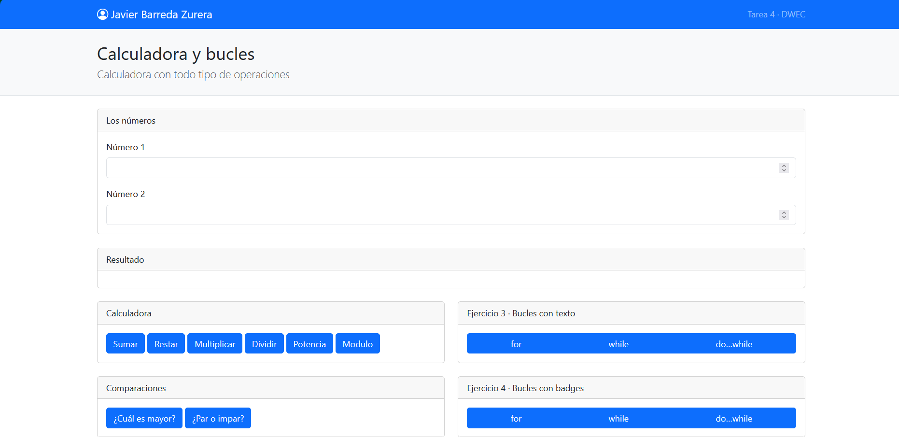
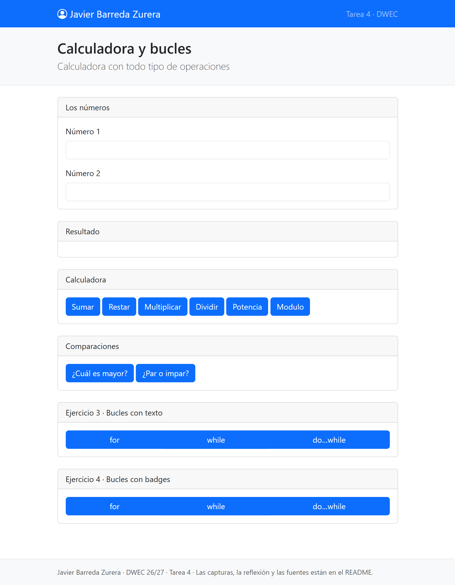
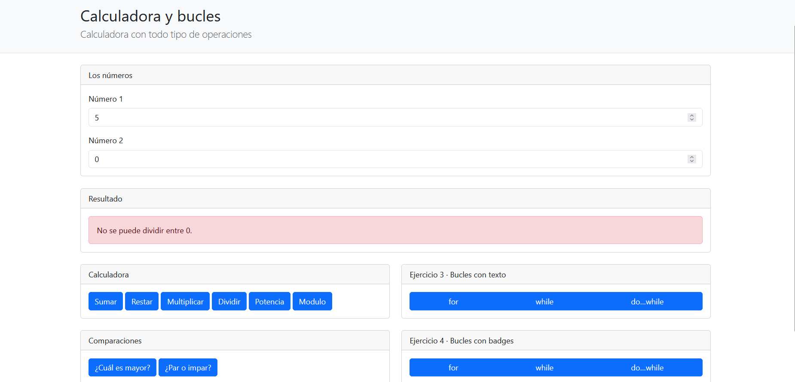
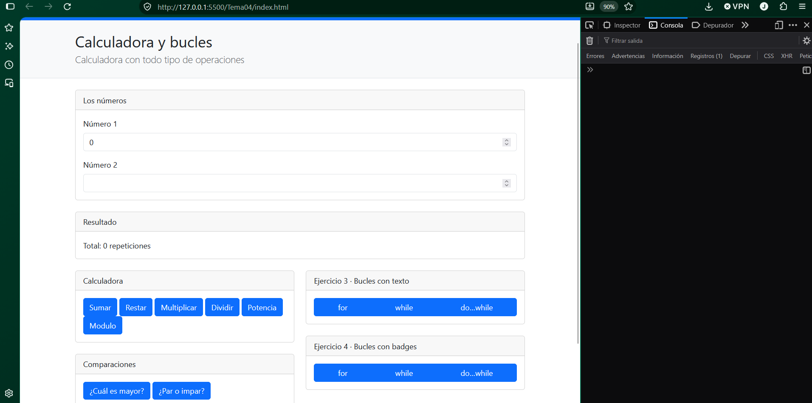
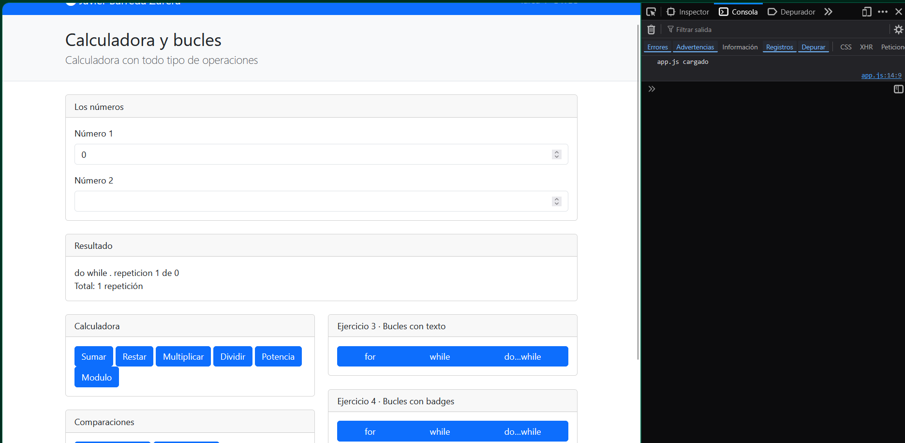
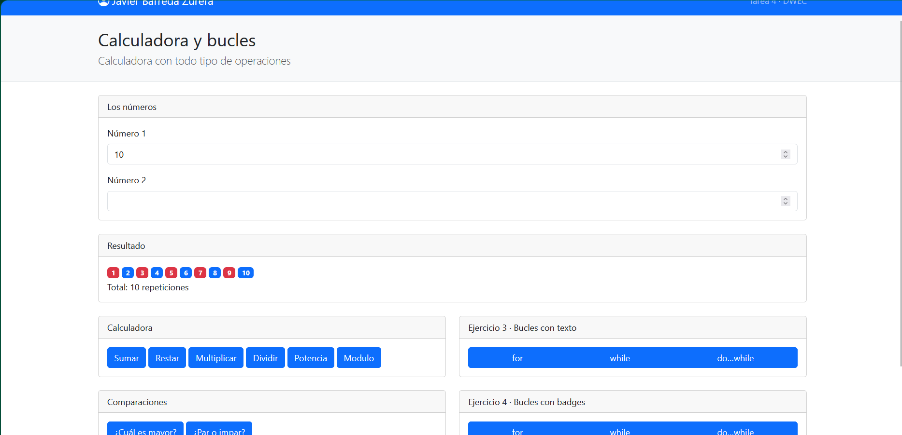

# Tarea 4 · Calculadora y bucles

**Autor:** Javier Barreda Zurera · Desarrollo Web en Entorno Cliente (DWEC) · 2.º DAW · Curso 2026-27

> **Plantilla de la tarea 4.** 

[Una o dos líneas: qué hay en esta carpeta y cómo se ve. Por ejemplo: abrir la carpeta en VS Code, pulsar **Go Live**, escribir dos números y pulsar los botones con la consola abierta (F12).]

## Capturas

### a) La página entera

Se ve mi nombre, lo que hace mi calculadora y las rejillas de los cuatro ejercicios repartidos en el navegador, en orden top left a bottom right.

### b) La página en el móvil

En este caso cambia la posición de los contenedores, ya que los de la derecha se desplazan hacia abajo.

### c) El error de dividir entre 0

En vez del infinity, Se ve el mensaje en rojo de que no se puede dividir entre 0. 

### d) Los tres bucles con el número 0

El bucle for y while no ejecutan ninguna repetición mientras que el do-while sí lo hace, haciendo al menos 1.

### e) Un bucle con badges

He puesto el número 10 para que saque 10 repeticiones, he elegido los colores azul y rojo, ya que son diferenciables y discordantes el uno con el otro.

## Reflexión

El bucle for lo utilizaría cuando sabes las veces que quieres que se repita algo, el bucle while lo usaría para repetir comandos o instrucciones siempre que cumpla la condición del código y el bucle do while para ejecutar el código al menos una vez y después comprueba la condición, por ejemplo, al introducir el número 0, for y while no se ejecutan ni una sola vez, en cambio do while lo ejecuta al menos una vez porque comprueba la condición al final. También usaría for para repetir un número concreto de veces, y while cuando dependa de una condición.

## Fuentes

- [Título de la página](https://enlace-a-la-fuente)

## Uso de IA

He usado la IA de ChatGpt para ayudarme a la estructura del primer bucle for del ejercicio 3, y para las rejillas del ejercicio 3 y 4 para poder colocarlas a la derecha y no abajo de los otros ejercicios.
