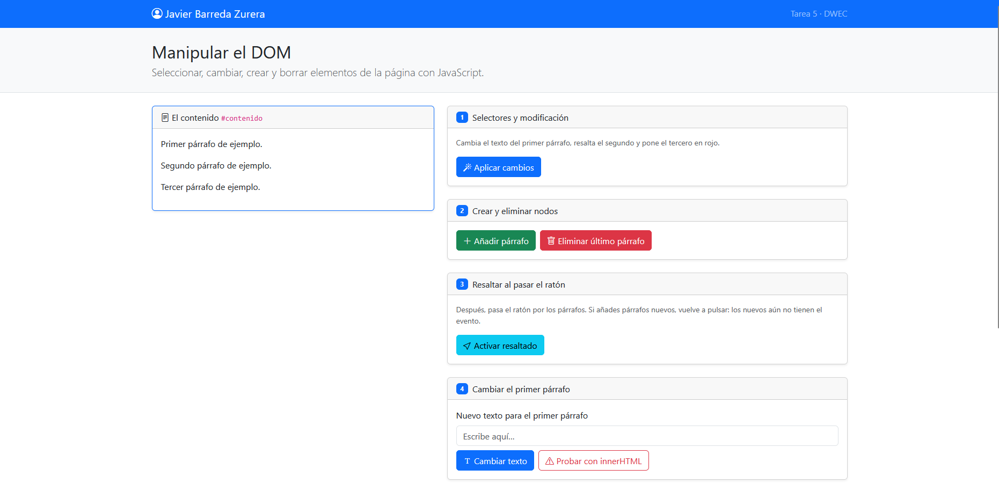
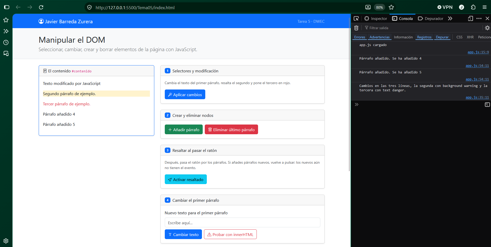
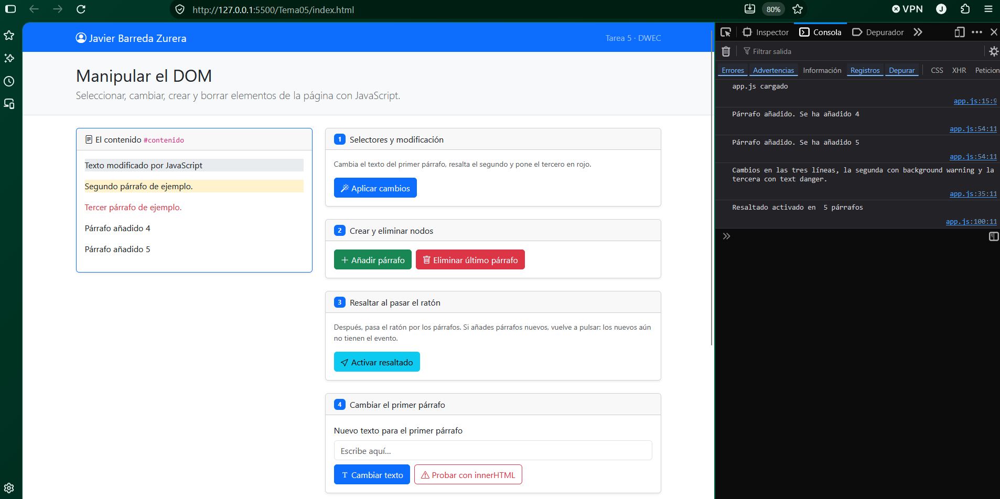
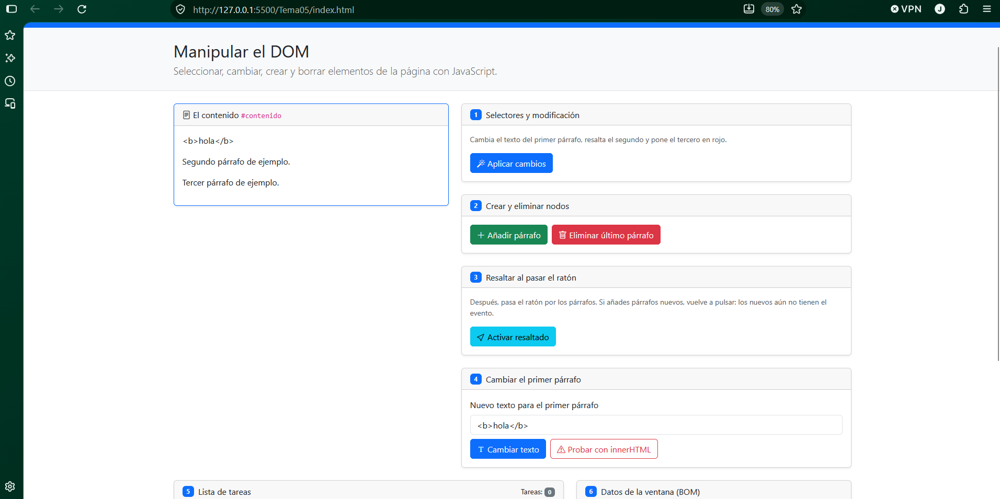
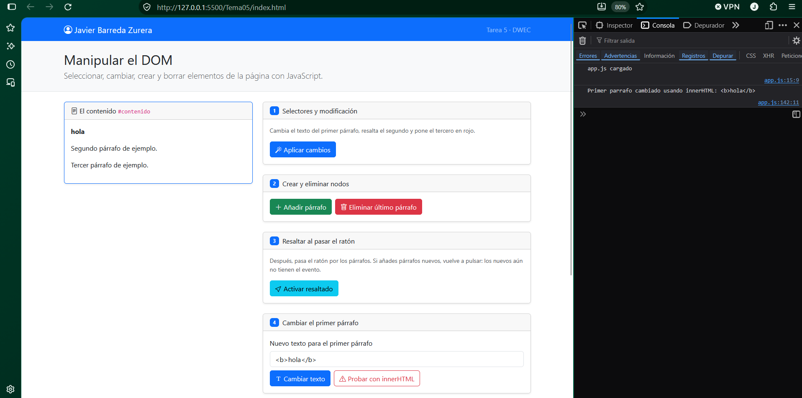
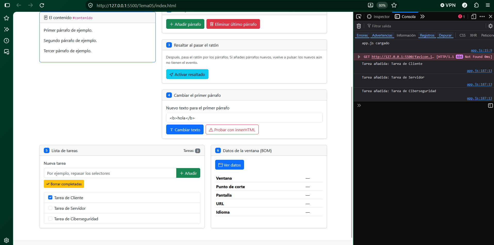
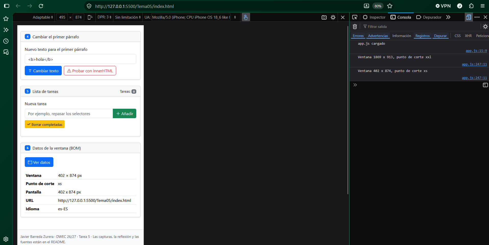

# Tarea 5 · Manipular el DOM

**Autor:** Javier Barreda Zurera · Desarrollo Web en Entorno Cliente (DWEC) · 2.º DAW · Curso 2026-27

Esta carpeta muestra una página con seis ejercicios que manipulan el DOM con app.js(javascript) , con selectores, crear y borrar parrafos y tareas, textContent y InnerHTML, resaltar con el cursor los párrafos y mostrar los datos de la ventana como el tamaño, url e idioma.

## Capturas

### a) La página recién cargada

Se ve mi nombre en el navbar y los tres párrafos que aparecen por defecto, todavia sin editar ni aplicar cambios.

### b) Ejercicios 1 y 2

Se muestran cambios en los tres primeros párrafos, el segundo párrafo con un background warning, y el tercer párrafo con un text danger. Al darle al botón de añadir párrafo, se añaden los párrafos por defecto 4 y 5.

### c) Ejercicio 3: resaltado al pasar el ratón

Se muestra el primer párrafo resaltado, y cada vez que añades un párrafo nuevo, se añade la función de resaltado el el total de párrafos que haya, es decir, el resaltado se aplica al poner el cursor sobre cualquier párrafo.

### d) Ejercicio 4: `<b>hola</b>` con innerHTML

Con textContent, sale la línea tal cual se escribe, con sus etiquetas html y todo, mientras que con innerHTML sale solo el texto de hola como en negrita. 

### e) Ejercicio 5: la lista de tareas

He añadido tres tareas y he marcado una antes de pulsar el botón de borrar completadas.
### f) Ejercicio 6: los datos de la ventana en el móvil

En la pantalla de mi ordenador sale el punto de corte xxl mientras que en la pantalla del móvil sale un punto de corte xs.

## Reflexión

La diferencia es que textContent inserta el contenido como texto plano, con sus etiquetas html y todo, mientras que innerHTML si que interpreta según que etiquetas, en este caso interpreta el !--<b>hola</b>--! como un hola con negrita por la etiqueta "bold".
La gravedad podría estar localizada en que cualquiera podría poner cualquier html, como una etiqueta  con un atributo "oneerror", se ejecutaría el javascript dentro de la página, y eso sería un ataque XSS. Por eso lo que escribe el usuario se pone siempre con textContent, que no ejecuta nada e innerHTML usarlo solo con el HTML que escriba yo.

## Fuentes

- [Título de la página](https://enlace-a-la-fuente)

## Uso de IA

Me he servido bastante de la Ia de Claude, ya que la práctica se me ha hecho bastante cuesta arriba a partir del ejercicio 4, por lo que me he servido de la ia para que me explique con detenimiento el código para poder entenderlo de los ejercicios 4 a 6, especialmente del 5, que lo he consdierado como el ejercicio más complicado y no sabía por donde empezar, y también para poder entender la diferencia entre textContent e innerHTML.
