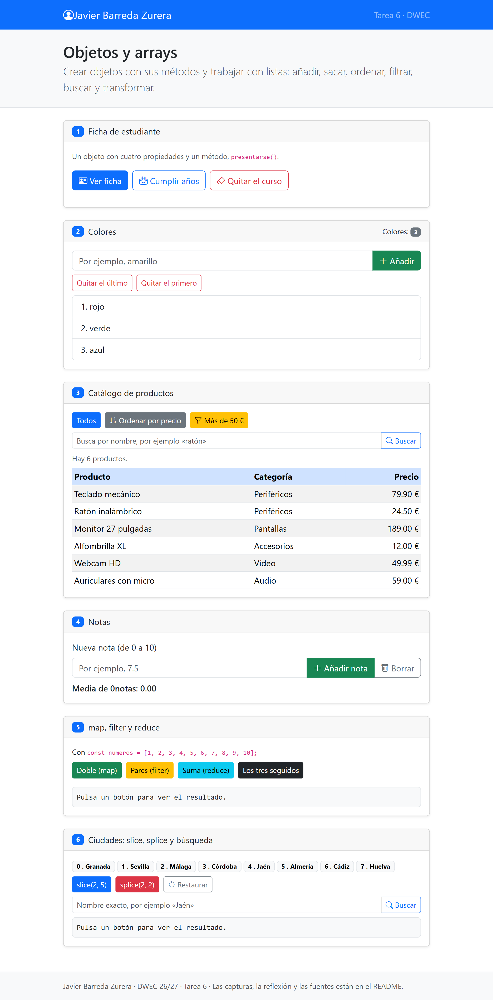
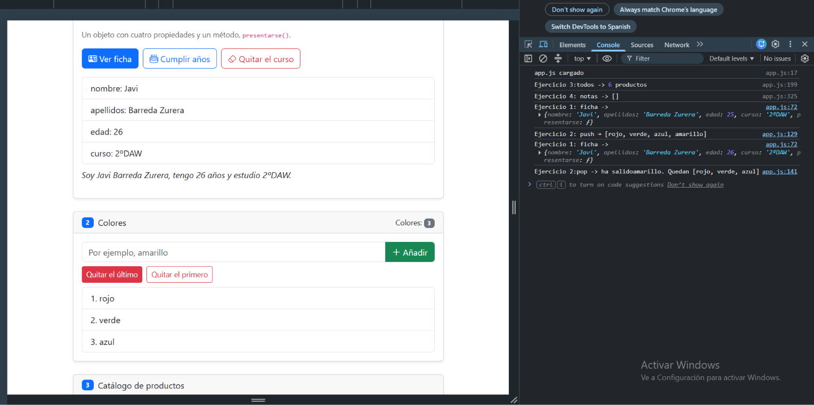
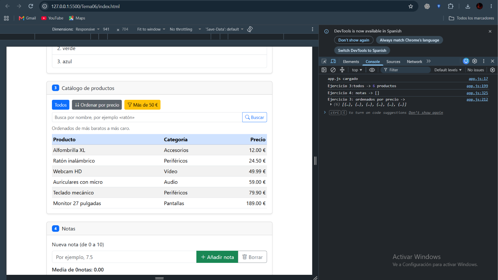
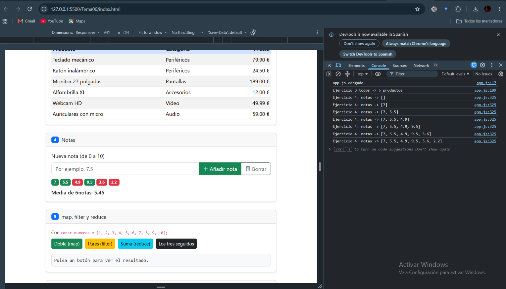
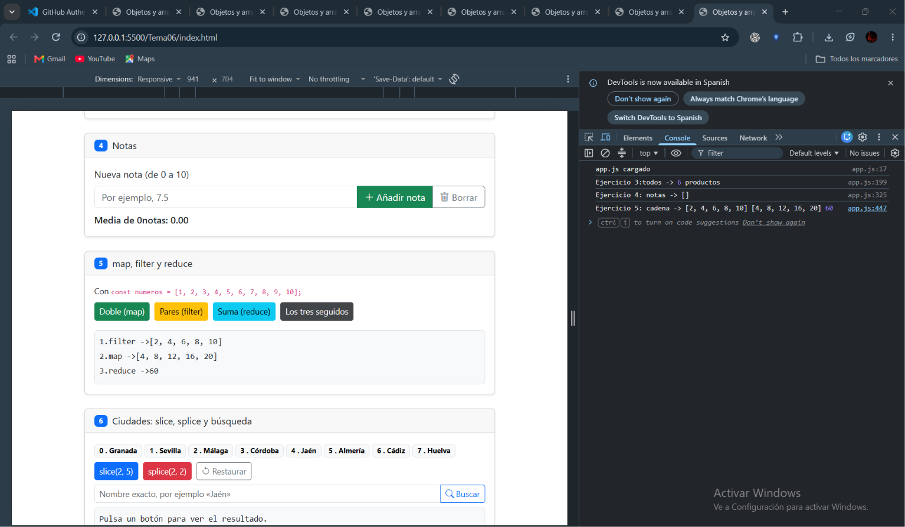
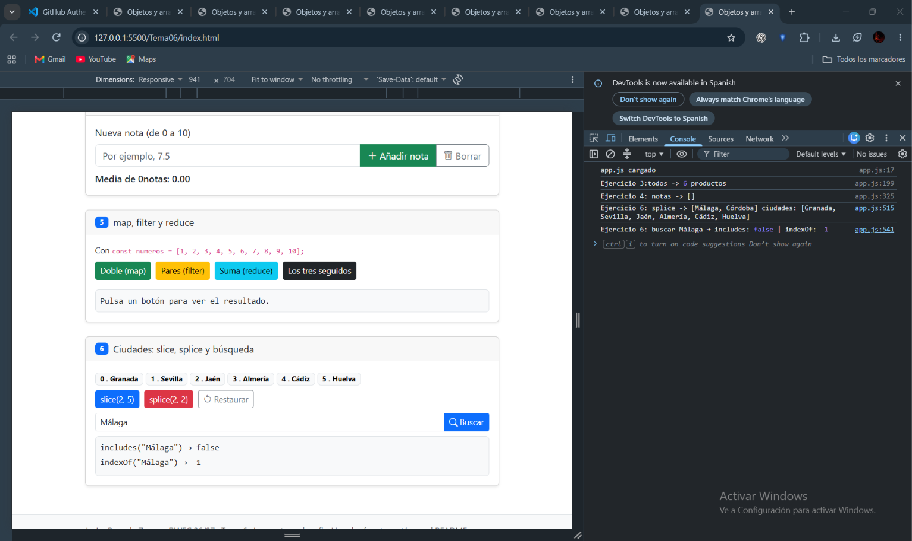

# Tarea 6 · Objetos y arrays

**Autor:** Javier Barreda Zurera · Desarrollo Web en Entorno Cliente (DWEC) · 2.º DAW · Curso 2026-27

> **Plantilla de la tarea 6.** Cómo usarla:

La carpeta contiene una página con su navbar y 6 ejercicios sobre objetos y arrays, incluye mi ficha de estudiante con mis datos personales, colores un catálogo de productos, notas que hacen media y que van del 0 al 10, botones que hacen map filter suma y cadena en un array de números y ciudades que puedes filtrar o cortar con slice y splice.

## Capturas

### a) La página recién cargada

Nada más cargar la página, se ve mi nombre en el navbar, la lista con los tres colores por defecto, la tabla con los seis productos y las ocho ciudades como badges.

### b) Ejercicios 1 y 2: la ficha y los colores

Al pulsar cumplir años se me ha sumado +1 a mi edad con estudiante.edad = estudiante.edad +1. En los colores he añadido amarillo y luego lo he eliminado con pop porque estaba el último en la lista.

### c) Ejercicio 3: el catálogo ordenado por precio

La función que he usado es function(a,b) con return a.precio - b.precio, que deja primero el producto más barato y el más caro el último y ejecuto una copia de productos con ...productos porque sort modifica el array sobre el que se llama.

### d) Ejercicio 4: las notas y la media

He añadido 6 notas, las de 5 o más, aparece con su badge en verde, y las de menos de 5 (he añadido un 4,9 para confirmar la condición) aparecen con su badge en rojo, y debajo se ve la media calculada con reduce.

### e) Ejercicio 5: los tres métodos seguidos

Al ser una cadena, se ejecutan seguido, filter se queda con los pares, map duplica los valores de filter, y reduce suma los valores duplicados de map.

### f) Ejercicio 6: después de splice y de buscar una ciudad

splice(2, 2) ha quitado Málaga y Córdoba, y el array se ha quedado con seis ciudades. He buscado «Jaén»: antes del splice indexOf daba 4 y después da 2, porque al quitar dos elementos anteriores los siguientes se renumeran. También he buscado málaga después del splice y da false, ya que había sido cortado previamente por el splice.

## Reflexión

Los métodos que cambian el array son el push, unshift, pop, shift, splice, sort y reverse. Los que devuelven un array nuevo sin tocar el original son slice, concat, map y filter; reduce devuelve un solo valor, y find, indexOf e includes solo buscan. En el ejercicio 6 se ve bien la diferencia: slice(2, 5) devuelve tres ciudades y ciudades sigue teniendo ocho, mientras que splice(2, 2) devuelve dos y deja el array con seis. Por eso en el ejercicio 3 ordeno una copia con ...productos y sort, que modifica el array sobre el que se llama, y si quisiera ordenar productos perdería su orden original y el botón «Todos» ya no mostraría el catálogo tal y como estaba antes.

## Fuentes

- [Título de la página](https://enlace-a-la-fuente)

## Uso de IA

He usado Claude (Anthropic) para que me ayudara a completar ciertas funciones que se me habían atraganado en varios ejercicios y no sabía como avanzar o no identificaba el error, en concreto las function de buscarCiudad y mostrarCiudades del ejercicio 6, la function de verCadena del ejercicio 5, y la funcion de verFicha del ejercicio 1. 
