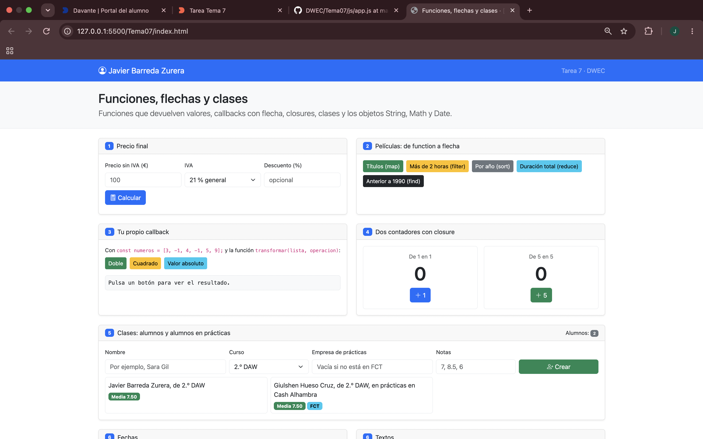
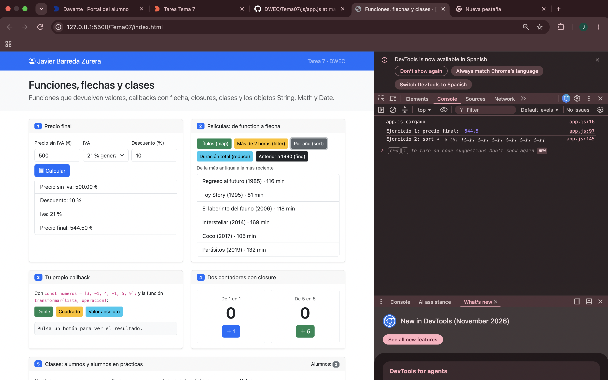
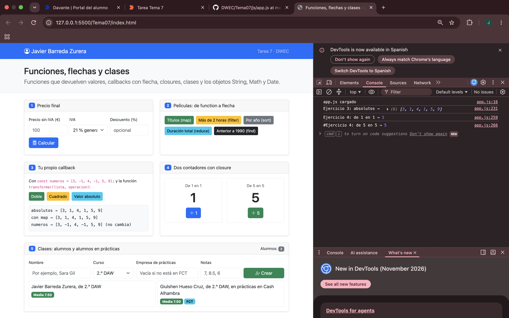
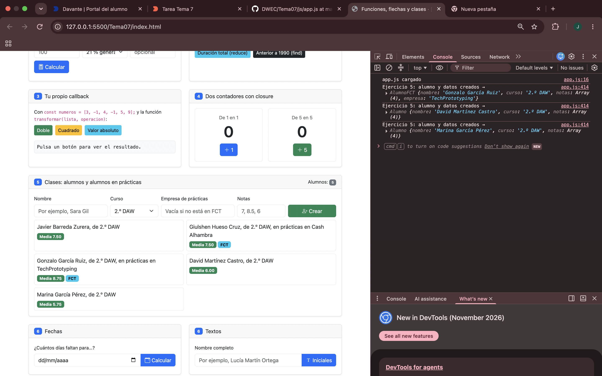
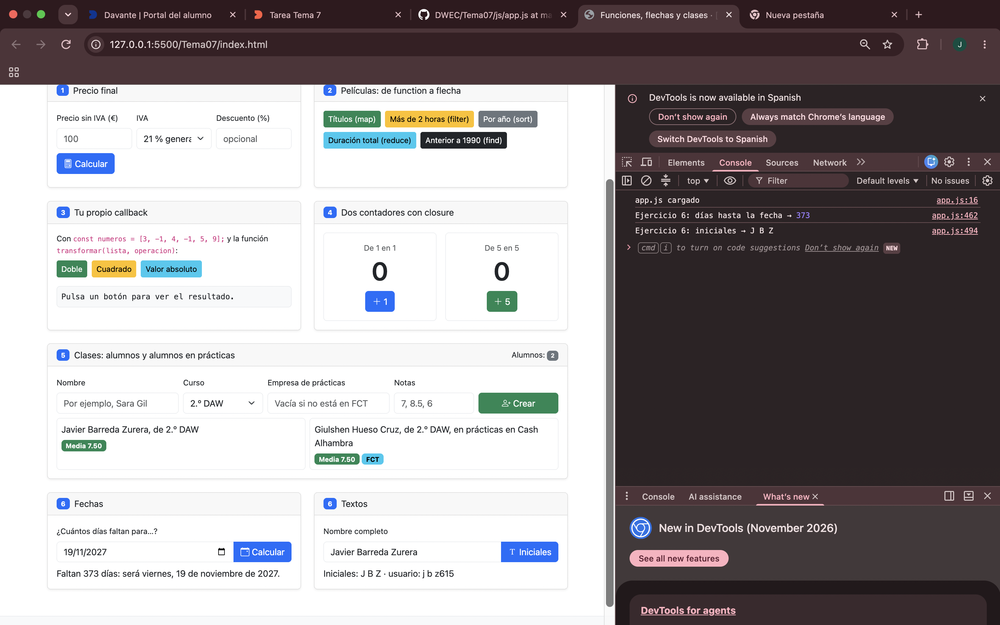

# Tarea 7 · Funciones, flechas y clases

**Autor:** Javier Barreda Zurera · Desarrollo Web en Entorno Cliente (DWEC) · 2.º DAW · Curso 2026-27

En esta carpeta está la tarea 7, con ejemplos de funciones, callbacks, closures, clases y manejo de fechas y textos. Para probarla, abre `index.html` con Live Server y pulsa los botones; los resultados aparecen en la página y los mensajes de seguimiento, en la consola del navegador (F12).

## Capturas

### a) La página recién cargada

Al cargar la página aparece mi nombre en la barra superior y las tarjetas de los dos alumnos iniciales. También se ven los formularios y controles de los seis ejercicios.

### b) Ejercicios 1 y 2: el precio y las películas

En el primer ejercicio se introduce un precio base y un descuento para obtener el precio final con IVA. `calcularPrecio()` calcula y devuelve el resultado; `mostrarPrecio()` lee los campos, comprueba los datos y muestra el desglose. En el segundo ejercicio, los botones usan métodos de arrays como `map`, `filter`, `sort`, `reduce` y `find` para mostrar y ordenar películas.

### c) Ejercicios 3 y 4: tu callback y los contadores

`transformar()` recorre la lista, aplica a cada elemento la operación recibida como callback y devuelve un array nuevo, sin cambiar el original. En el ejercicio 4, cada llamada a `crearContador()` crea su propia variable `cuenta`; por eso el contador de uno en uno y el de cinco en cinco avanzan de forma independiente.

### d) Ejercicio 5: los alumnos

La lista muestra cinco alumnos, incluidos alumnos en prácticas. Al crear uno, el programa lo instancia como `Alumno` si no se indica una empresa; si se escribe una empresa, crea un `AlumnoFCT`, que hereda de `Alumno` y añade la información de prácticas. También valida las notas y calcula la media.

### e) Ejercicio 6: fechas y textos

He probado la fecha 19 de noviembre de 2027: faltan 373 días. La diferencia entre fechas se convierte a días y se redondea con `Math.round()` porque los cambios de hora pueden hacer que la resta no equivalga exactamente a un número entero de días. La otra tarjeta obtiene las iniciales y genera un nombre de usuario.

## Reflexión

- Una función flecha permite escribir callbacks breves y conserva el valor de `this` del contexto en el que se creó.
- Uso `return` cuando necesito devolver un resultado, como en `calcularPrecio()` o `transformar()`.
- En una función flecha de una sola expresión, el resultado se devuelve de forma implícita; con llaves hace falta escribir `return`.
- Los métodos de las clases los escribo con la sintaxis propia de método, no como propiedades con flechas.
- Así, `media()` puede usar `this.notas` para consultar las notas del alumno.
- En `transformar(numeros, (n) => n * 2)`, la flecha define la operación que se aplica a cada número.

## Fuentes

- [Funciones flecha (MDN)](https://developer.mozilla.org/es/docs/Web/JavaScript/Reference/Functions/Arrow_functions)
- [Clases (MDN)](https://developer.mozilla.org/es/docs/Web/JavaScript/Reference/Classes)
- [Array (MDN)](https://developer.mozilla.org/es/docs/Web/JavaScript/Reference/Global_Objects/Array)

## Uso de IA

He usado el Copilot de VSCode como apoyo para completar algunas partes y explicar más detalladamente el Readme.md. He usado Claude para ayudarme a completar y contrastar los apartados del ejercicio 5 y 6 del archivo app.js.
